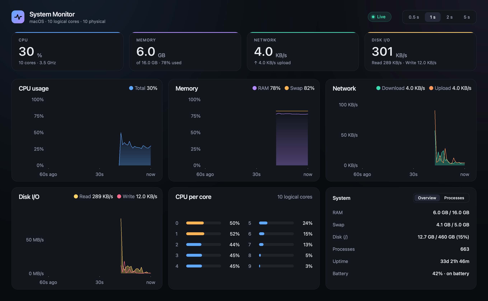

# System Monitor

A live system monitor (CPU, memory, network, disk) with animated charts.
Built with Python, PySide6, psutil and pyqtgraph.



- Live charts for CPU, memory, network and disk I/O over the last 60 seconds
- Hover any chart to read the exact values at that moment
- Per-core CPU load, system info, and a **Top processes** view (switch in the bottom-right card)
- Refresh every 0.5 / 1 / 2 / 5 s; animation pauses while the window is minimized

## Run

```
python -m venv venv
venv/bin/pip install -r requirements.txt
venv/bin/python src/main.py
```

## Develop

```
venv/bin/pip install -r requirements-dev.txt
venv/bin/pytest              # run all tests
venv/bin/ruff check .        # lint (add --fix to sort imports etc.)
```

## Build a macOS app

```
venv/bin/pip install -r requirements-dev.txt
venv/bin/python scripts/build_app.py      # -> dist/System Monitor.app (a few minutes the first time)
```

Needs the Xcode Command Line Tools (`xcode-select --install`). The app is ad-hoc signed,
so on another Mac the first launch needs right-click → Open.

## Where to find things

```
src/
├── main.py               Entry point (creates the app and shows the window)
├── config/
│   └── settings.py       Behaviour settings: refresh intervals, history length, window size
├── monitors/             Reads the machine (psutil) and returns plain data. No Qt.
│   ├── sampler.py        Takes a Snapshot of CPU, memory, network, disk, battery
│   ├── processes.py      Top processes by CPU
│   ├── system_info.py    Core count, OS name, battery present?
│   └── models.py         The data types (Snapshot, ProcessInfo, ...)
├── services/             Runtime plumbing
│   ├── sampling_service.py   Timer that samples and publishes Snapshots
│   ├── process_service.py    Reads top processes in small slices so animation never stutters
│   └── render_loop.py        ~60 fps clock that drives the animations
├── utils/                Pure helpers
│   ├── formatting.py     "1.2 MB/s", "3d 7h 21m", ...
│   └── animation.py      Easing math
└── ui/                   Everything on screen
    ├── main_window.py    Lays out the panels, connects services to widgets
    ├── theme.py          Colors and fonts
    ├── components/       Small building blocks: card, labels, logo, live badge, segmented controls
    ├── charts/           Line chart, hover readout, per-core bars, axis labels
    └── panels/           Dashboard sections: header, KPI tile, CPU per core, system / top processes
scripts/                  make_icon.py (app icon from the logo), build_app.py (macOS .app)
tests/                    pytest: formatting, sampler + processes (fake psutil), offscreen window smoke test
```

Common changes:

| I want to...                         | Look in                         |
|--------------------------------------|---------------------------------|
| Change refresh options / window size | `src/config/settings.py`        |
| Change colors or the font            | `src/ui/theme.py`               |
| Change how a number is displayed     | `src/utils/formatting.py`       |
| Add or change a measured metric      | `src/monitors/` then `main_window.py` |
| Change a chart's look or axes        | `src/ui/charts/`                |
| Change a card, tile or the header    | `src/ui/panels/`, `src/ui/components/` |
| Change animation speed               | `src/config/settings.py` (easing constants) |

## License

MIT, see [LICENSE](LICENSE).
